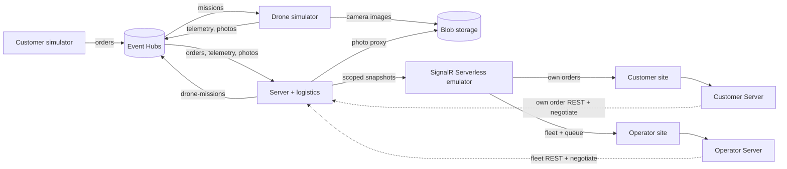

# Drone delivery architecture: design phase

## Starting point

This spike follows the
[`aspire-ts-cs-starter` layout](https://github.com/microsoft/aspire/tree/3ed1c753769b7fb0edd28beede32e4639d39acd8/src/Aspire.ProjectTemplates/templates/aspire-ts-cs-starter):
C# AppHost, C# Minimal API, two Vite/React sites and service-discovery-based
Vite proxying. `customer-frontend` references `DroneDelivery.CustomerServer`;
`operator-frontend` references `DroneDelivery.OperatorServer`. Each UI host
publishes only its own assets into its own `wwwroot`, as in the upstream starter.
Both hosts reference the authoritative `DroneDelivery.Server` backend through
service discovery; neither duplicates logistics or order/fleet state.
The sample's product UI and illustrations are original to this spike.

The template targets Aspire 17.0 and .NET 10. Until Aspire 17.0.0 is on nuget.org,
its `NuGet.config` maps `Aspire.*` packages to the Aspire release feed. No existing
template is modified.

The workers communicate only through Event Hubs. The drone simulator owns drone
physics and the camera; the server owns logistics (which drone, when, and the
estimated delivery); the customer simulator only generates demand. Consumers
start at the latest event, so restarting a worker does not replay old missions.

## What exists

| Component | Responsibility | Current boundary |
| --- | --- | --- |
| AppHost | Start emulators, workers, backend, two UI servers and two Vite apps | No deployment target configured |
| Domain library | Drone classes, VTOL flight legs, logistics planner, dispatcher and event contracts | Pure .NET; unit tested |
| Drone simulator | Fleet of Piccolo/Doppio/Abbondante drones; missions, charging, telemetry, camera shots | In-memory fleet; SVG placeholder images |
| Customer simulator | Peak-and-quiet demand from many customers at random drop-offs | Synthetic only |
| API and logistics | Accept orders, assign drones, estimate delivery, expose fleet/orders/photos | In-memory order state; no persistence |
| Customer React site | Payload selection, coffee builder, tray, own orders/tracking and scripted transcript matching | POST orders; scoped realtime receipt subscriptions; up to 20 localStorage receipts; no real authentication |
| Operator React site | All stores, fleet, dispatch queue, battery and queued work | Initial REST snapshot plus operator realtime stream; latest 100 orders; no browser simulation |
| CustomerServer / OperatorServer | Serve independent frontends and proxy backend REST/negotiate routes | No Event Hubs consumers, dispatch logic or authoritative state |
| Simulated drone camera | Lazily loaded three.js view positioned by assigned-order telemetry; separate last captured blob frame | Placeholder scenery; not video; Azure Maps tiles only with the reviewer's token |
| Frontend source | Independent app-local map/transport/theme assets; customer-only menu and receipt helpers | Some duplication keeps container build contexts self-contained; no cross-app imports |
| ServiceDefaults and tracing | OpenTelemetry for every .NET project; `DroneDelivery` spans across HTTP, Event Hubs (`traceparent` in event properties), dispatch, mission legs, camera/blob work, SignalR publishes and browser receipt of stage changes; `DroneDelivery` meter for position ingestion and SignalR sends | Browser spans relayed through `/otlp` by the Vite dev server or, for built sites, the UI server; SignalR service internals not traceable; no PII in span attributes or IDs in metric tags |
| Azure Maps adapter | Real basemap and fictional animated markers | Opt-in reviewer token, no refresh or resource provisioning |

Customer receipts are capped at 20 entries, and quantities at nine per recipe or treat. Confirmed orders snapshot
the payload size and each coffee's size, milk, shots, sugar and temperature.
Canonical variant IDs merge only identical recipes. Payload capacity uses integer
quarter-well units: single/double/quad hold 4/8/16; every item uses four units.
Validation runs again at confirmation; UI controls cannot
overfill or shrink below the contents. These are illustrative local UX bounds,
not platform capacity guarantees. No shared automation artifacts or claims are
created by this implementation.

The server validates service-area coordinates, item count and selected payload
capacity; recipe pricing remains illustrative client code. Order progress uses
preparation timestamps and explicit pickup/delivery milestones, not drone position.
An assigned drone may still be flying an earlier mission: the single-order endpoint
includes a live fix only for a matching order ID, and the customer ignores fixes
older than 30 seconds. Network failures hide live tracking and show an explicit
error. The same camera component persists through pickup and delivery. Ground loading/
unloading waits continue to emit telemetry, so a stationary drone does not become
an artificially stale fix during pickup.

The selected transport is Azure SignalR Service **Serverless mode**, using the
Aspire-managed local emulator. Default-mode ASP.NET hubs cannot use that emulator.
The backend uses the Management SDK to publish to separate customer and operator
hubs; UI hosts negotiate clients against the service. Customer users are scoped
to their receipt order IDs, and no fleet-wide operator payload is broadcast to
customer clients. Reconnect reloads authoritative snapshots before updates resume.
This is SignalR, not Web PubSub, and it does not silently fall back to polling.

Receipt IDs filter the customer experience, not access to the API. There is no
authentication/authorization; server-owned state resets on restart. Add an access
boundary and persistence before treating this as a real customer service.

## Azure Maps findings

The Web SDK supports the required browser basemap and moving HTML markers.
South Melbourne is centered near longitude 144.96, latitude -37.83. The fictional
positions use a small approximate rectangle around that area, not surveyed
store/flight data. The SVG default is independently illustrated approximate
geography and does not fetch mapping tiles.

The SDK can use an Azure Maps account client ID with anonymous callback-based
delivery of an Entra access token. The spike accepts a manually obtained
short-lived token, keeps it only in memory and shows SDK errors. This establishes
an integration path, not authenticated production readiness; it has not been
tested against a live account.

Production direction: a backend token endpoint using managed identity with
**Azure Maps Data Reader** scoped to the Maps account. An anonymous demo must
not become an unrestricted token vending service: explicitly design token
lifetime/refresh, endpoint access, rate controls, allowed origins/account
settings and spend monitoring. Account client IDs are identifiers; keys and
bearer tokens must never enter source control or static frontend configuration.
All Azure provisioning needs separate owner approval.

References:
[authentication](https://learn.microsoft.com/azure/azure-maps/azure-maps-authentication),
[SDK authentication callback](https://learn.microsoft.com/azure/azure-maps/how-to-secure-webapp-users),
[pricing](https://azure.microsoft.com/pricing/details/azure-maps/).

## Next architecture steps

Orders, dispatch and the drone fleet now run on the backend. Next, move menus,
recipe pricing and payload validation into the server, and stream fleet and order
updates with authorization and persistence. Both sites already show backend
simulation state through SignalR. Keep the single-company ForthCoffee scope.
Evaluate persistence and messaging against demonstrable sample value and the
local prerequisites, rather than adding Azure services solely for a diagram.

Speech capture and transcription should produce a transcript for a
catalog-constrained AI interpretation layer. Validate product IDs/options/
quantities on the server, disclose uncertainty and preserve explicit customer
confirmation. Do not retain raw audio. Keep a testable provider-independent
local path. The current deterministic text matcher is not an AI implementation.

The eventual `aspire deploy` path must guide Azure configuration and verify the
deployed customer/operations sites from a fresh generated project. The current
per-UI-server `PublishWithContainerFiles` wiring is packaging groundwork, not evidence that
Azure deployment works. No successful deployment is claimed.
