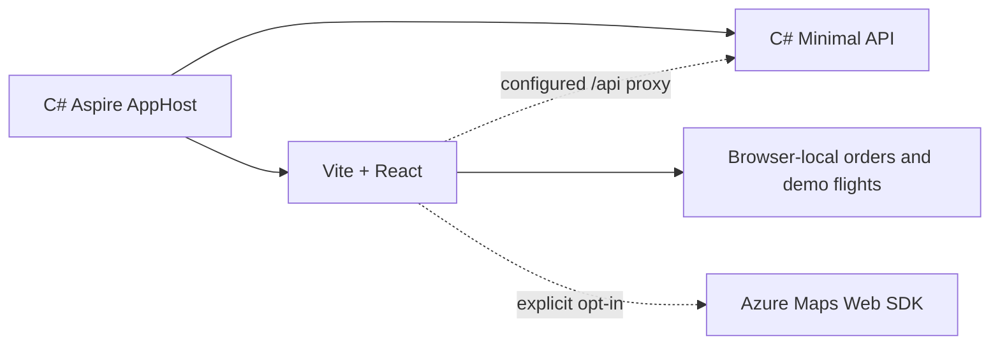

# Drone delivery architecture: design phase

## Starting point

This spike follows the
[`aspire-ts-cs-starter` layout](https://github.com/microsoft/aspire/tree/3ed1c753769b7fb0edd28beede32e4639d39acd8/src/Aspire.ProjectTemplates/templates/aspire-ts-cs-starter):
C# AppHost, C# Minimal API, a Vite/React frontend and service-discovery-based
Vite proxying. The AppHost references the server from the frontend and publishes
the frontend's container files into server `wwwroot`, as in the upstream starter.
The sample's product UI and illustrations are original to this spike.

The design uses published Aspire 13.6.5 packages and .NET 10; it does not claim
the final Aspire CLI 17.0+ acceptance check has happened. Matching later package/
CLI versions is a release-readiness item. No existing template is modified.

## What exists

| Component | Responsibility | Current boundary |
| --- | --- | --- |
| AppHost | Start the API and Vite frontend; expose resources in the dashboard | No deployment target configured |
| API | Health endpoint, demo metadata and published frontend hosting | No order mutations or persistence |
| React UI | Customer/vendor views, bag, confirmed orders, order status page and scripted transcript matching | In-memory, per browser; hash route only; no real authentication |
| Simulated drone camera | Lazily loaded three.js view of the assigned drone's route over a map-textured ground plane | Placeholder scenery; not video; Azure Maps tiles only with the reviewer's token |
| Simulation | Timed preparation, pickup, delivery, synthetic orders and a deterministic flight for customer orders | Other drones are illustrative loops; not real dispatch |
| Azure Maps adapter | Real basemap and fictional animated markers | Opt-in reviewer token, no refresh or resource provisioning |

Simulation order history is capped at 20 recent entries, synthetic active orders
at eight, and quantities at nine per menu item. These are local demo UX bounds,
not platform capacity guarantees. No shared automation artifacts or claims are
created by this implementation.

## Azure Maps findings

The Web SDK supports the required browser basemap and moving HTML markers.
Mornington is centered near longitude 145.04, latitude -38.22. The fictional
positions use a small approximate rectangle around that area, not surveyed
store/flight data. The SVG default is independently illustrated approximate
geography and does not fetch mapping tiles.

The SDK can use an Azure Maps account client ID with anonymous callback-based
delivery of an Entra access token. The spike accepts a manually obtained
short-lived token, keeps it only in memory and shows SDK errors. This establishes
an integration path, not authenticated production readiness; it has not been
tested against a live account.

Production direction: a backend token endpoint using managed identity with
**Azure Maps Data Reader** scoped to the Maps account. An anonymous demo must
not become an unrestricted token vending service: explicitly design token
lifetime/refresh, endpoint access, rate controls, allowed origins/account
settings and spend monitoring. Account client IDs are identifiers; keys and
bearer tokens must never enter source control or static frontend configuration.
All Azure provisioning needs separate owner approval.

References:
[authentication](https://learn.microsoft.com/azure/azure-maps/azure-maps-authentication),
[SDK authentication callback](https://learn.microsoft.com/azure/azure-maps/how-to-secure-webapp-users),
[pricing](https://azure.microsoft.com/pricing/details/azure-maps/).

## Proposed next architecture, not implemented

Keep the app readable. First move menus/orders and the deterministic simulator
into the server; stream state updates to the frontend, provisionally with
ASP.NET Core SignalR. Add store locations and explicit drone
pickup/delivery/return/charging state before selecting managed service variants.
Evaluate persistence and messaging against demonstrable sample value and the
local prerequisites, rather than adding Azure services solely for a diagram.

Speech capture and transcription should produce a transcript for a
catalog-constrained AI interpretation layer. Validate product IDs/options/
quantities on the server, disclose uncertainty and preserve explicit customer
confirmation. Do not retain raw audio. Keep a testable provider-independent
local path. The current deterministic text matcher is not an AI implementation.

The eventual `aspire deploy` path must guide Azure configuration and verify the
deployed customer/vendor experience from a fresh generated project. The current
`PublishWithContainerFiles` wiring is packaging groundwork, not evidence that
Azure deployment works. No successful deployment is claimed.
