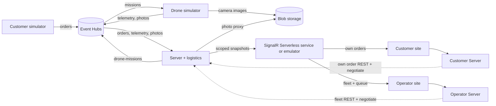

# Drone delivery architecture

## Starting point

This demo follows the
[`aspire-ts-cs-starter` layout](https://github.com/microsoft/aspire/tree/3ed1c753769b7fb0edd28beede32e4639d39acd8/src/Aspire.ProjectTemplates/templates/aspire-ts-cs-starter):
C# AppHost, C# Minimal API, two Vite/React sites and service-discovery-based
Vite proxying. `customer-frontend` references `DroneDelivery.CustomerServer`;
`operator-frontend` references `DroneDelivery.OperatorServer`. Each UI host
publishes only its own assets into its own `wwwroot`, as in the upstream starter.
Both hosts reference the authoritative `DroneDelivery.Server` backend through
service discovery; neither duplicates logistics or order/fleet state.
The sample's product UI and illustrations are original to this demo.

The template targets Aspire 17.0 and .NET 10. Until Aspire 17.0.0 is on nuget.org,
its `NuGet.config` maps `Aspire.*` packages to the Aspire release feed. No existing
template is modified.

The workers communicate only through Event Hubs. The drone simulator owns drone
physics and the camera; the server owns logistics (which drone, when, and the
estimated delivery); the customer simulator only generates demand. Consumers
start at the latest event, so restarting a worker does not replay old missions.

## What exists

| Component | Responsibility | Current boundary |
| --- | --- | --- |
| AppHost | Start emulators, workers, backend, two UI servers and two Vite apps | Azure Container Apps target configured; end-to-end Azure deployment unverified |
| Domain library | Drone classes, VTOL flight legs, logistics planner, dispatcher and event contracts | Pure .NET; unit tested |
| Drone simulator | Fleet of Piccolo/Doppio/Abbondante drones; missions, charging, telemetry, camera shots | In-memory fleet; SVG placeholder images |
| Customer simulator | Peak-and-quiet demand from many customers at random drop-offs | Synthetic only |
| API and logistics | Accept orders, assign drones, estimate delivery, expose fleet/orders/photos | Orders written through to Cosmos DB (serverless; vNext emulator locally) and restored on restart; lost restored missions are re-dispatched or failed |
| Customer React site | Payload selection, coffee builder, tray, own orders/tracking | POST orders; scoped realtime receipt subscriptions; up to 20 localStorage receipts; no real authentication |
| Operator React site | All stores, fleet, dispatch queue, battery, queued work and a per-drone camera/command drawer | Initial REST snapshot plus operator realtime stream; latest 100 orders; commands go through the backend |
| CustomerServer / OperatorServer | Serve independent frontends and proxy backend REST/negotiate routes | No Event Hubs consumers, dispatch logic or authoritative state |
| Simulated drone camera | Shared, lazily loaded Three.js renderer; buffered position/heading/camera-pitch telemetry, with actual nearby fleet models | OSM building footprints (ODbL, bundled extract) on OSM ground tiles; not video; independent SVG Blob captures |
| Frontend source | Independent sites with customer-only menu/receipt helpers and common `frontend-shared` camera/pose/artwork source | One npm workspace and build context; separate site builds are copied into their matching UI servers |
| ServiceDefaults and tracing | OpenTelemetry for every .NET project; `DroneDelivery` spans across HTTP, Event Hubs (`traceparent` in event properties), dispatch, mission legs, camera/blob work, SignalR publishes and browser receipt of stage changes; `DroneDelivery` meter for position ingestion and SignalR sends | Browser spans relayed through `/otlp` by the Vite dev server or, for built sites, the UI server; SignalR service internals not traceable; no PII in span attributes or IDs in metric tags |
| OpenStreetMap basemap | Leaflet with OSM raster tiles and fictional drone/store/route markers | Public tile server for demo/dev traffic only; attribution required |

Customer receipts are capped at 20 entries, and quantities at nine per recipe or treat. Confirmed orders snapshot
the payload size and each coffee's size, milk, shots, sugar and temperature.
Canonical variant IDs merge only identical recipes. Payload capacity uses integer
quarter-well units: single/double/quad hold 4/8/16; every item uses four units.
Validation runs again at confirmation; UI controls cannot
overfill or shrink below the contents. These are illustrative local UX bounds,
not platform capacity guarantees. No shared automation artifacts or claims are
created by this implementation.

The server validates service-area coordinates, item count and selected payload
capacity; recipe pricing remains illustrative client code. Order progress uses
preparation timestamps and explicit pickup/delivery milestones, not drone position.
An assigned drone may still be flying an earlier mission: the single-order endpoint
includes a live fix only for a matching order ID, and the customer ignores fixes
older than 30 seconds. Network failures hide live tracking and show an explicit
error. The same camera component persists through pickup and delivery. Ground loading/
unloading waits continue to emit telemetry, so a stationary drone does not become
an artificially stale fix during pickup.

The selected transport is Azure SignalR Service **Serverless mode**, using the
Aspire-managed local emulator. Default-mode ASP.NET hubs cannot use that emulator.
The backend uses the Management SDK to publish to separate customer and operator
hubs; UI hosts negotiate clients against the service. Customer users are scoped
to their receipt order IDs. Customer updates include at most 24 nearby camera
poses (ID, timestamp, position, altitude, heading, pitch), without the other orders'
IDs, contents or mission details. No operator snapshot is broadcast to customers.
Reconnect reloads authoritative snapshots before updates resume.
This is SignalR, not Web PubSub, and it does not silently fall back to polling.

Receipt IDs filter the customer experience, not access to the API. There is no
authentication/authorization; fleet state resets on restart, while orders persist in
Cosmos DB. Add an access boundary before treating this as a real customer service.

## Drone cameras and operator interventions

The live feed never uses Blob images. Both sites render the same Three.js scene
from telemetry carried by the existing SignalR snapshots. A bounded 12-pose buffer
per drone plays two seconds behind, interpolating position, altitude, camera pitch,
airframe pitch/roll and shortest-arc heading. It never extrapolates beyond the newest fix or bridges gaps
over five seconds; a paused-telemetry label appears after ten seconds. Nearby
drones older than 30 seconds are hidden. The drone model is procedural and is
placed at its reported coordinates, not on an illustrative loop. Co-located hulls
within one map unit of the lens are hidden to avoid enclosing the camera; there
is no drone-to-drone separation. Static building avoidance is performed by the
simulator, not the renderer. A heading-aware airspace
inset plots current fleet positions so drones outside the camera frustum remain
visible without changing the streamed camera direction.

`POST /api/fleet/{droneId}/commands?command=...` accepts EmergencyLanding,
ReturnToBase, DiscardPackage or Reactivate. The dispatcher reserves the drone
against new work while the command travels through `drone-missions` with W3C trace
context. The simulator unwinds the current mission at its actual pose, reports an
Interrupted milestone, releases queued missions and executes the command. An
interrupted active order becomes Failed and retains its receipt; queued orders
return to AwaitingFleet with new mission IDs on reassignment. Old milestones
cannot complete a reassigned order. Already delivered orders are not failed.

Emergency landing descends in place and leaves the drone Grounded, excluded from
dispatch. Reactivate explicitly returns it home before availability resumes.
Return-to-base unloads only at home. Discard requires a package and visits the
fictional `ServiceArea.Waste` point before releasing it and returning home.
Telemetry carries the command ID, execution status and package presence; the
drawer shows acknowledgment or rejection rather than claiming HTTP 202 is
completion. Commands execute serially per drone. Mission spans and command spans
are connected with links, and the capture queue preserves its enqueue-time context.

Flight legs preserve arrival heading through landing and turn toward the next
leg during ascent. Mid-air diversions start at the current altitude and blend
heading during their ascent; an emergency descent has no horizontal leg. Camera
pitch is explicit simulator telemetry, forward in cruise and downward for VTOL,
with transitions near the top of climb/start of descent. Storage work runs in a
separate bounded 64-frame queue so it cannot block flight updates. SVG images
snapshot the capture-time pose, remain explicitly illustrative, and are not
browser-canvas screenshots.

`BuildingAirspace` embeds the camera's OSM footprint extract. It expands building
bounding boxes by 6 m and plans low-clearance flights. An A* search over tall-building
corners weighs horizontal length against climb energy: each metre of vertical change
costs about 2.3 m of level flight, derived from the drone's battery rates. Edges that
cross terrain above the 120 m ceiling are blocked. The search is limited to 600 m of
extra distance and is a heuristic, not a globally optimal 3D plan. A vertical profile
sampled every 5 m then holds each part of the route at the required clearance (at
least 20 m en route, plus 10 m over the start and end pads). It applies the climb
gradient limit (vertical speed / cruise speed) forward and backward, then simplifies
the profile without ever dropping below it. Tests check clearance continuously along
the flown trajectory, including take-off and landing. Untagged buildings
use a conservative 12 m envelope (the renderer's estimation ceiling).
Pads in these envelopes sit above the roof. Battery estimates add the profile's
total climb and descent to the horizontal distance. An unsafe starting pose, an
unsurveyed endpoint or an impossible route produces an explicit routing failure,
not a fabricated direct flight. The operator drawer exposes routing failures.

Each horizontal segment accelerates/brakes at 2 m/s². At bends, the drone stops
and turns for three seconds before moving on. Duration and battery estimates
use these routes. Bounded sinusoidal pitch/roll/yaw model gentle attitude
correction, without position drift into buildings. Telemetry carries speed,
attitude and the planned waypoints, including VTOL endpoints. The overhead maps
and translucent Three.js flight line/gates use those exact waypoints. Neighbor
camera poses still exclude other orders and routes. This is not a dynamic
air-traffic or certified obstacle-avoidance system.

## Map provider

Both sites use a shared Leaflet component (`frontend-shared/OsmMap.tsx`) over
standard OpenStreetMap raster tiles, with themed drone, store and route overlays
driven by the same telemetry as before. The illustrated coordinate space maps to
real South Melbourne coordinates (`frontend-shared/mapGeometry.ts`). The camera
ground fetches a bounded set of zoom-16 tiles once per page, two requests at a
time, and falls back to the illustrated ground on failure. Browser tracing
ignores tile fetches. Tiles rely on the browser HTTP cache plus a per-page
tile and composited-ground cache, so remounts and drone switches don't refetch.
Camera buildings are a committed, simplified OSM footprint extract
(`frontend-shared/osm-buildings.json`, ODbL) generated once at authoring time;
untagged heights use the nearest tagged building, capped at 12 m.

The public `tile.openstreetmap.org` server suits demo and development traffic
only ([tile usage policy](https://operations.osmfoundation.org/policies/tiles/)):
attribution is shown on every map and on the camera, and there is no
prefetching or bulk download. Production use needs a commercial or self-hosted
tile provider, which is a one-line URL change in `frontend-shared/osm.ts`.

## Next architecture steps

Orders, dispatch and the drone fleet now run on the backend. Next, move menus,
recipe pricing and payload validation into the server, and stream fleet and order
updates with authorization. Both sites already show backend
simulation state through SignalR. Keep the single-company ForthCoffee scope.
Evaluate further messaging and storage against demonstrable sample value and the
local prerequisites, rather than adding Azure services solely for a diagram.

The AppHost targets Azure Container Apps and uses Aspire's native Vite builds and
per-server `PublishWithContainerFiles` wiring. The backend and simulators are
limited to one replica for their in-memory state and event consumers; this is not
a highly available design. A successful end-to-end Azure deployment from a fresh
generated project has not yet been verified.
