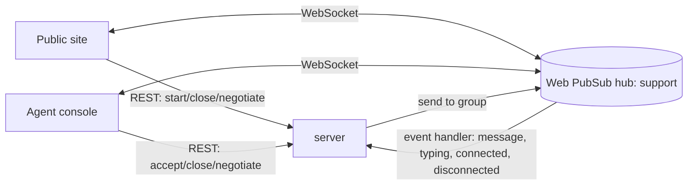

# Support desk (Aspire + Azure Web PubSub)

A real-time customer support demo built on the Aspire TypeScript + C# starter. It has two frontends and one API:

| Resource | What it is |
| --- | --- |
| `publicsite` | Public website for a fictitious utility company, with a support launcher in the bottom-right corner. |
| `agentconsole` | Support desk where human agents see the queue, accept chats and reply. |
| `server` | ASP.NET Core API that owns conversation state and routes messages through Web PubSub. |
| `webpubsub` | Azure Web PubSub, running as the local emulator during development. |



## Requirements

- .NET 10 SDK, Node.js 20.19+ or 22.13+, and Docker (for the Web PubSub emulator).
- Aspire 17 or later. The Web PubSub emulator (`RunAsEmulator`) is not available in Aspire 13.x.

`aspire new` selects the latest stable `Aspire.Hosting.AppHost` version at or above 17.0.0 from the configured NuGet sources and uses it for all Aspire packages. `dotnet new` defaults to 17.0.0.

## Run

```bash
aspire new aspire-support-desk -n SupportDemo
cd SupportDemo
aspire run
```

Open the `publicsite` and `agentconsole` URLs from the dashboard in two browser windows. Sign in to the console with any display name, start a chat from the support button on the public site, then accept and reply from the console.

## How it works

- Customers start a conversation over REST and receive a conversation key. Negotiation returns a Web PubSub client URL whose token is scoped to that conversation's group.
- Agents negotiate into the `agents` group, which receives queue updates. Accepting a chat adds the agent to the conversation group.
- Chat messages and typing indicators are sent as Web PubSub user events. The server validates that the sender belongs to the conversation, stores the message and publishes it to the conversation group.
- The AppHost registers the server's `/eventhandler` endpoint with the hub, so the emulator calls it for user and connection events.
- Conversations are kept in memory and are lost when the server restarts.

## Brand

Brand text lives in the `Brand` section of the server's `appsettings.json`. Both frontends read it from `/api/brand`. The default brand is Contoso, a fictitious company used for demonstration only; review brand usage for your own scenario before publishing.

## Before production

This is a demo. Before using it with real customers:

- Add authentication for agents (the console trusts any display name).
- Validate the Web PubSub event handler signature (`ce-signature`). The emulator does not sign requests, so the sample skips this check.
- Replace the in-memory conversation store with durable storage.

## Deploy

The AppHost targets Azure Container Apps for `aspire deploy`, using an [Azure Container Apps Express](https://learn.microsoft.com/azure/container-apps/express-overview) environment (`AsExpress()`, preview) so it provisions quickly and scales to zero. Express environments don't include the managed Aspire dashboard; remove `.AsExpress()` for a standard environment. In publish mode the server hosts the built public site at `/` and the agent console at `/agent`, and Azure Web PubSub is provisioned for the hub.
